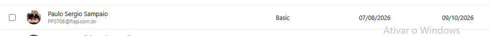
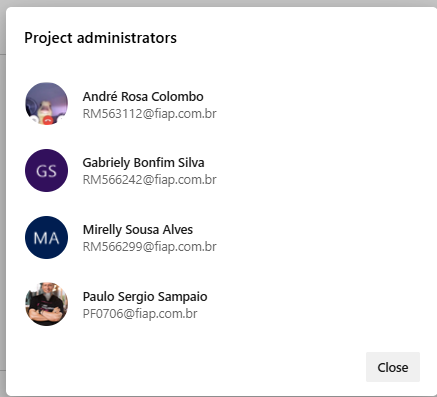

# Sprint 4 — Plano de testes manuais de sistema

## Link Organização Azure DevOps
https://dev.azure.com/RM566299/Olli-pet

### Acessos Professor

## Integrantes

| RM | Integrante |
|---:|---|
| 566299 | Mirelly Sousa Alves |
| 563112 | André Rosa Colombo |
| 566242 | Gabriely Bonfim Silva |
| 562917 | Henrique Rodrigues Vespasiano |
| 562218 | Ruan Luca Feliciano de Carvalho |

## Challenge Clyvo — Projeto Olli-pet

Este plano organiza os testes manuais dos **PBIs da Sprint 4** do projeto Olli-pet no Azure DevOps. Cada PBI possui quatro Test Cases, cadastrados pelo botão **Add Test**. Em cada Test Case, cada etapa possui uma **Action** (ação executada) e seu próprio **Expected Result** (saída esperada daquela etapa), conforme o modelo do Azure Test Plans.

## PBIs da Sprint 4

1. **Proteção dos dados sensíveis**
2. **Controle de acesso da clínica**
3. **Visualização do histórico pela clínica**
4. **Visualização dos pets pela clínica**
5. **Acompanhamento das ações preventivas**
6. **Comunicação de informações preventivas**
7. **Consulta de orientações recebidas**

## Plano de testes por PBI

### PBI 1 — Proteção dos dados sensíveis

#### Caso de teste 1 — Teste de dados sensíveis não serem exibidos para perfil sem autorização

**Dados de entrada:** Usuário de teste sem permissão; cadastro fictício de tutor com telefone e documento.

| Etapa | Action (ação) | Expected Result (saída esperada por etapa) |
|---:|---|---|
| 1 | Entrar no sistema com o usuário de teste sem autorização. | O sistema autentica o usuário conforme seu cadastro, sem conceder permissões além das atribuídas ao perfil. |
| 2 | Abrir a tela em que os dados do tutor poderiam aparecer. | A tela é apresentada apenas com as informações permitidas ao perfil; os campos sensíveis não são exibidos sem autorização. |
| 3 | Tentar abrir os detalhes dos dados sensíveis, pelo controle disponível na interface. | O sistema bloqueia a consulta não autorizada e não revela o telefone, documento ou outros dados protegidos. |
| 4 | Atualizar a tela e conferir novamente os campos. | Após a atualização, os dados sensíveis continuam indisponíveis para esse perfil e não aparecem por causa do recarregamento. |

#### Caso de teste 2 — Teste de exibição controlada de dados sensíveis em tela de detalhes

**Dados de entrada:** Usuário autorizado; cadastro de tutor com dados fictícios preenchidos.

| Etapa | Action (ação) | Expected Result (saída esperada por etapa) |
|---:|---|---|
| 1 | Entrar com o perfil autorizado. | O sistema autentica o usuário e reconhece as permissões previstas para o perfil. |
| 2 | Acessar o cadastro do tutor de teste. | O sistema abre o cadastro correspondente ao tutor selecionado. |
| 3 | Conferir os campos sensíveis na tela de detalhes. | Os dados sensíveis são exibidos somente no contexto autorizado e conforme as regras de visualização do sistema. |
| 4 | Navegar para outra tela e retornar ao cadastro. | Os dados continuam disponíveis apenas no contexto autorizado; não são exibidos indevidamente em telas que não precisam deles. |

#### Caso de teste 3 — Teste de dados sensíveis não aparecerem em mensagens de erro

**Dados de entrada:** Cadastro fictício com dados sensíveis e operação que gere erro de validação controlado.

| Etapa | Action (ação) | Expected Result (saída esperada por etapa) |
|---:|---|---|
| 1 | Abrir a tela de cadastro ou edição. | O sistema apresenta o formulário esperado para o cadastro ou edição. |
| 2 | Informar os dados fictícios nos campos correspondentes. | Os campos aceitam os dados de teste conforme suas validações, sem expor essas informações em outros locais da tela. |
| 3 | Provocar uma validação inválida usando um campo obrigatório ou formato incorreto. | O sistema identifica a entrada inválida e não conclui a operação. |
| 4 | Conferir a mensagem de validação apresentada. | A mensagem explica o problema sem reproduzir documento, telefone ou outros dados sensíveis completos. |

#### Caso de teste 4 — Teste de proteção dos dados após encerramento da sessão

**Dados de entrada:** Usuário autorizado com acesso a uma tela de dados sensíveis.

| Etapa | Action (ação) | Expected Result (saída esperada por etapa) |
|---:|---|---|
| 1 | Entrar no sistema com o usuário de teste. | O sistema inicia a sessão do usuário autenticado. |
| 2 | Abrir a tela que contém os dados sensíveis. | A tela apresenta os dados permitidos para aquele usuário enquanto a sessão está ativa. |
| 3 | Encerrar a sessão pelo comando de sair/logout. | O sistema encerra a sessão e direciona o usuário para a tela pública ou de autenticação. |
| 4 | Usar o botão Voltar do navegador ou acessar novamente o endereço protegido. | O sistema exige nova autenticação e não disponibiliza os dados protegidos após o encerramento da sessão. |

### PBI 2 — Controle de acesso da clínica

#### Caso de teste 1 — Teste de acesso à área da clínica com credenciais válidas

**Dados de entrada:** Usuário ativo, vinculado a uma clínica e autorizado a acessar a área clínica.

| Etapa | Action (ação) | Expected Result (saída esperada por etapa) |
|---:|---|---|
| 1 | Abrir a tela de login. | A tela de autenticação é exibida com os campos necessários para entrar no sistema. |
| 2 | Informar as credenciais válidas do usuário de teste. | Os campos recebem as credenciais informadas, sem erro de validação de preenchimento. |
| 3 | Enviar o formulário de login. | O sistema autentica o usuário porque as credenciais são válidas. |
| 4 | Acessar a área da clínica. | A área clínica é aberta e apresenta somente funcionalidades e dados permitidos ao perfil e à clínica vinculada. |

#### Caso de teste 2 — Teste de login com credenciais inválidas

**Dados de entrada:** Usuário inexistente ou senha incorreta, sem utilizar credenciais reais.

| Etapa | Action (ação) | Expected Result (saída esperada por etapa) |
|---:|---|---|
| 1 | Abrir a tela de login. | A tela de autenticação é apresentada. |
| 2 | Informar credenciais inválidas. | O formulário recebe os dados digitados para a tentativa de autenticação. |
| 3 | Tentar entrar no sistema. | A autenticação é negada e nenhuma sessão autenticada é iniciada. |
| 4 | Conferir a mensagem exibida e a navegação. | O sistema apresenta mensagem adequada, sem revelar detalhes que permitam confirmar dados sensíveis de uma conta específica, e permanece fora da área protegida. |

#### Caso de teste 3 — Teste de usuário sem vínculo com clínica tentar acessar a área clínica

**Dados de entrada:** Usuário válido sem vínculo ou permissão para acessar a clínica de teste.

| Etapa | Action (ação) | Expected Result (saída esperada por etapa) |
|---:|---|---|
| 1 | Entrar com o usuário de teste sem vínculo com a clínica. | O sistema autentica o usuário sem conceder vínculo ou permissão inexistente. |
| 2 | Tentar abrir a área clínica pelo menu. | A opção é ocultada ou o acesso é bloqueado, conforme o comportamento definido para o perfil. |
| 3 | Tentar acessar diretamente o endereço de uma página clínica. | O sistema verifica a autorização no acesso direto e bloqueia a página não autorizada. |
| 4 | Conferir o conteúdo apresentado após a tentativa. | Nenhum dado ou funcionalidade da clínica sem vínculo é exibido ao usuário. |

#### Caso de teste 4 — Teste de tentativa de acesso após encerramento da sessão

**Dados de entrada:** Usuário que acessou a área clínica e realizou logout.

| Etapa | Action (ação) | Expected Result (saída esperada por etapa) |
|---:|---|---|
| 1 | Autenticar-se com um usuário autorizado da clínica. | O sistema inicia a sessão autenticada. |
| 2 | Abrir uma página protegida da área clínica. | A página exibe os dados autorizados enquanto a sessão está ativa. |
| 3 | Sair do sistema pelo comando de logout. | A sessão é encerrada e o usuário sai da área autenticada. |
| 4 | Tentar abrir novamente o endereço protegido. | O acesso é bloqueado ou o usuário é direcionado à autenticação, sem exibição dos dados da clínica. |

### PBI 3 — Visualização do histórico pela clínica

#### Caso de teste 1 — Teste de exibição do histórico do pet selecionado

**Dados de entrada:** Pet Olli com consulta em 05/10/2026, vacina em 20/10/2026 e check-up em 30/10/2026; usuário autorizado da clínica vinculada.

| Etapa | Action (ação) | Expected Result (saída esperada por etapa) |
|---:|---|---|
| 1 | Entrar na área com o usuário autorizado da clínica. | O sistema autentica o usuário e permite acesso à área clínica vinculada. |
| 2 | Abrir o perfil do Olli. | O sistema exibe o perfil do pet Olli, sem abrir o cadastro de outro animal. |
| 3 | Acessar a seção de histórico. | A área de histórico é carregada para o Olli. |
| 4 | Conferir os eventos, datas e descrições. | O histórico apresenta a consulta, a vacina e o check-up vinculados ao Olli, com dados correspondentes aos registros cadastrados. |

#### Caso de teste 2 — Teste de ordenação cronológica do histórico

**Dados de entrada:** Histórico com eventos em 05/10/2026, 20/09/2026 e 30/10/2026.

| Etapa | Action (ação) | Expected Result (saída esperada por etapa) |
|---:|---|---|
| 1 | Abrir o histórico do pet de teste. | O sistema exibe os eventos existentes no histórico selecionado. |
| 2 | Conferir a ordem dos eventos apresentados. | Os eventos aparecem na ordem cronológica definida para a tela, utilizando as datas dos registros e não a ordem de cadastro acidental. |
| 3 | Atualizar a página. | O histórico é carregado novamente sem erro. |
| 4 | Conferir novamente a sequência dos eventos. | A ordem cronológica permanece correta após a atualização da página. |

#### Caso de teste 3 — Teste de histórico vazio

**Dados de entrada:** Pet cadastrado sem consulta ou evento de saúde registrado.

| Etapa | Action (ação) | Expected Result (saída esperada por etapa) |
|---:|---|---|
| 1 | Entrar na área da clínica com usuário autorizado. | O sistema permite o acesso à área clínica conforme as permissões do usuário. |
| 2 | Abrir o perfil do pet sem histórico. | O sistema exibe o perfil do pet selecionado. |
| 3 | Acessar a seção de histórico. | O sistema apresenta um estado vazio ou mensagem informando que não há histórico cadastrado. |
| 4 | Conferir se existem erros ou registros de outros pets. | A tela permanece funcional, sem erro técnico e sem exibir eventos pertencentes a outro animal. |

#### Caso de teste 4 — Teste de isolamento do histórico entre pets

**Dados de entrada:** Pet Olli com registro de vacinação e pet Nina com registro de consulta.

| Etapa | Action (ação) | Expected Result (saída esperada por etapa) |
|---:|---|---|
| 1 | Abrir o histórico do Olli. | O sistema carrega o histórico associado ao Olli. |
| 2 | Conferir os registros apresentados para o Olli. | O registro de vacinação aparece no histórico do Olli e não aparecem eventos exclusivos da Nina. |
| 3 | Abrir o histórico da Nina. | O sistema carrega o histórico associado à Nina. |
| 4 | Conferir os registros apresentados para a Nina. | O registro de consulta da Nina aparece corretamente e não há mistura com os registros do Olli. |

### PBI 4 — Visualização dos pets pela clínica

#### Caso de teste 1 — Teste de listagem dos pets vinculados à clínica

**Dados de entrada:** Clínica Vet Vida com os pets Olli e Nina vinculados.

| Etapa | Action (ação) | Expected Result (saída esperada por etapa) |
|---:|---|---|
| 1 | Entrar com usuário autorizado da Clínica Vet Vida. | O sistema autentica o usuário e identifica o vínculo com a Clínica Vet Vida. |
| 2 | Abrir a área de pets. | A listagem de pets da clínica é apresentada. |
| 3 | Conferir se Olli e Nina aparecem na lista. | Os pets vinculados à clínica são exibidos com as informações previstas para a listagem. |
| 4 | Abrir o registro de cada pet listado. | Cada seleção abre o perfil correspondente ao pet escolhido, sem trocar os dados entre os animais. |

#### Caso de teste 2 — Teste de isolamento da listagem entre clínicas

**Dados de entrada:** Clínica Vet Vida com Olli; Clínica Bicho Feliz com Nina.

| Etapa | Action (ação) | Expected Result (saída esperada por etapa) |
|---:|---|---|
| 1 | Entrar com usuário da Clínica Vet Vida. | O sistema autentica o usuário e reconhece a clínica à qual ele está vinculado. |
| 2 | Abrir a listagem de pets. | A listagem apresenta os pets autorizados para a Clínica Vet Vida. |
| 3 | Pesquisar ou procurar Nina na listagem da Clínica Vet Vida. | Nina, vinculada somente à outra clínica, não aparece nem pode ser acessada por esse usuário. |
| 4 | Repetir o teste com o usuário da Clínica Bicho Feliz. | O usuário da Clínica Bicho Feliz visualiza Nina e somente os pets autorizados para sua clínica. |

#### Caso de teste 3 — Teste de busca por pet existente e inexistente

**Dados de entrada:** Lista contendo Olli e Nina; termos de busca Olli e PetInexistente.

| Etapa | Action (ação) | Expected Result (saída esperada por etapa) |
|---:|---|---|
| 1 | Abrir a lista de pets da clínica. | A lista de pets autorizados é exibida e o campo de busca fica disponível, caso previsto na interface. |
| 2 | Pesquisar por Olli. | A busca retorna o pet Olli correspondente ao termo pesquisado. |
| 3 | Conferir os dados do resultado encontrado. | O resultado apresenta os dados de Olli e permite abrir somente o registro correspondente. |
| 4 | Pesquisar por PetInexistente. | O sistema apresenta estado sem resultados ou mensagem equivalente, sem erro técnico e sem mostrar pets não relacionados. |

#### Caso de teste 4 — Teste de listagem vazia de pets

**Dados de entrada:** Clínica de teste sem pets vinculados.

| Etapa | Action (ação) | Expected Result (saída esperada por etapa) |
|---:|---|---|
| 1 | Entrar com usuário autorizado da clínica sem pets. | O sistema autentica o usuário e reconhece a clínica de teste. |
| 2 | Abrir a área de pets. | A área de listagem é carregada sem apresentar registros de outras clínicas. |
| 3 | Conferir a mensagem ou estado exibido. | O sistema informa que não há pets para exibir, ou apresenta o estado vazio previsto no produto. |
| 4 | Atualizar a página. | A listagem continua vazia e funcional, sem erro nem inclusão de pets de outra clínica. |

### PBI 5 — Acompanhamento das ações preventivas

#### Caso de teste 1 — Teste de visualização das ações preventivas do pet

**Dados de entrada:** Pet Olli com vacinação pendente, check-up concluído e vermifugação pendente.

| Etapa | Action (ação) | Expected Result (saída esperada por etapa) |
|---:|---|---|
| 1 | Acessar o perfil do Olli. | O sistema exibe o perfil do pet selecionado. |
| 2 | Abrir a seção de acompanhamento preventivo. | O sistema carrega as ações preventivas associadas ao Olli. |
| 3 | Conferir as ações, datas e status apresentados. | Vacinação, check-up e vermifugação aparecem com os dados cadastrados e os respectivos status, sem registros de outro pet. |

#### Caso de teste 2 — Teste de atualização do status de uma ação preventiva

**Dados de entrada:** Ação de vacinação do Olli com status Pendente.

| Etapa | Action (ação) | Expected Result (saída esperada por etapa) |
|---:|---|---|
| 1 | Abrir o acompanhamento preventivo do Olli. | A vacinação pendente é apresentada na lista de ações do pet. |
| 2 | Selecionar o registro de vacinação. | O sistema abre os detalhes ou controles de edição da vacinação selecionada. |
| 3 | Alterar o status para Concluído, conforme as opções disponíveis. | O novo status é selecionado e permanece associado somente à vacinação escolhida. |
| 4 | Salvar e atualizar a página. | O status Concluído fica salvo e continua exibido após a atualização, sem retornar ao status anterior. |

#### Caso de teste 3 — Teste de identificação de ação preventiva atrasada

**Dados de entrada:** Ação preventiva com data anterior à data de execução do teste e status não concluído.

| Etapa | Action (ação) | Expected Result (saída esperada por etapa) |
|---:|---|---|
| 1 | Abrir a seção de acompanhamento preventivo. | O sistema apresenta as ações preventivas cadastradas para o pet. |
| 2 | Localizar a ação com data vencida. | A ação é encontrada com a data anterior à data de execução e status ainda não concluído. |
| 3 | Conferir sua classificação e status. | A ação é identificada como atrasada ou vencida conforme a regra definida nos critérios de aceite; não é apresentada incorretamente como concluída. |
| 4 | Atualizar a página e conferir novamente. | A classificação e o status continuam coerentes com a data e com o registro salvo. |

#### Caso de teste 4 — Teste de atualização de uma ação não alterar as demais

**Dados de entrada:** Olli com três ações preventivas distintas, cada uma com data e status próprios.

| Etapa | Action (ação) | Expected Result (saída esperada por etapa) |
|---:|---|---|
| 1 | Abrir o acompanhamento preventivo do Olli. | As três ações aparecem individualmente com seus dados atuais. |
| 2 | Editar apenas a data ou o status de uma ação. | O formulário de edição identifica a ação escolhida, sem selecionar nem alterar os outros registros. |
| 3 | Salvar a alteração. | O sistema salva a mudança para a ação selecionada e mantém a associação correta com o Olli. |
| 4 | Conferir as três ações na listagem. | Somente a ação editada apresenta o novo valor; as datas, os status e as descrições das demais permanecem inalterados. |

### PBI 6 — Comunicação de informações preventivas

#### Caso de teste 1 — Teste de envio de informação preventiva ao destinatário correto

**Dados de entrada:** Informação preventiva de vacinação associada ao pet Olli e ao tutor de teste cadastrado.

| Etapa | Action (ação) | Expected Result (saída esperada por etapa) |
|---:|---|---|
| 1 | Abrir a funcionalidade de comunicação preventiva. | A tela ou formulário de comunicação é exibido ao usuário autorizado. |
| 2 | Selecionar o pet Olli e a informação preventiva. | A comunicação fica associada ao pet e à informação selecionados. |
| 3 | Conferir o destinatário antes do envio. | O destinatário exibido corresponde ao tutor cadastrado para o Olli. |
| 4 | Acionar o envio ou o fluxo de envio disponível. | O sistema processa a solicitação e apresenta o resultado correspondente ao canal implementado. |
| 5 | Conferir o registro da comunicação. | O registro identifica a informação, o pet e o destinatário corretos, além do status de envio disponível no sistema. |

#### Caso de teste 2 — Teste de envio sem campos obrigatórios

**Dados de entrada:** Comunicação sem uma informação obrigatória e/ou sem destinatário.

| Etapa | Action (ação) | Expected Result (saída esperada por etapa) |
|---:|---|---|
| 1 | Abrir a funcionalidade de comunicação preventiva. | O sistema apresenta o formulário de comunicação. |
| 2 | Deixar vazio um campo obrigatório. | O campo permanece sem valor e pode ser identificado pela validação da interface. |
| 3 | Tentar enviar a comunicação. | O sistema impede o envio porque faltam dados obrigatórios. |
| 4 | Conferir a mensagem de validação e os registros. | O sistema indica o dado que precisa ser preenchido e não registra a comunicação como enviada. |

#### Caso de teste 3 — Teste de duplo acionamento não duplicar a comunicação

**Dados de entrada:** Comunicação válida pronta para envio ao tutor de teste.

| Etapa | Action (ação) | Expected Result (saída esperada por etapa) |
|---:|---|---|
| 1 | Preencher os dados da comunicação e conferir o destinatário. | A comunicação está preenchida com os dados válidos e o destinatário esperado. |
| 2 | Acionar o envio duas vezes rapidamente, caso a interface permita. | O sistema processa a solicitação de acordo com sua regra de prevenção de duplicidade; não confirma duas comunicações idênticas indevidamente. |
| 3 | Consultar os registros de comunicação. | Existe somente o registro esperado para a ação de envio, conforme a regra implementada. |
| 4 | Atualizar a tela e consultar novamente. | A atualização não cria registros adicionais nem duplica a comunicação já registrada. |

#### Caso de teste 4 — Teste de resultado do envio ser apresentado ao usuário

**Dados de entrada:** Comunicação válida em ambiente de teste; retorno de sucesso ou falha disponibilizado pelo canal.

| Etapa | Action (ação) | Expected Result (saída esperada por etapa) |
|---:|---|---|
| 1 | Preparar uma comunicação válida no ambiente de teste. | Os dados obrigatórios estão preenchidos e a comunicação está pronta para envio. |
| 2 | Executar o envio pelo canal disponível no ambiente. | O sistema recebe o retorno de processamento disponibilizado pelo canal, quando esse retorno estiver implementado. |
| 3 | Conferir a mensagem apresentada ao usuário e o status registrado. | A mensagem e o status refletem o resultado recebido; o sistema não informa sucesso quando o retorno indica falha. |
| 4 | Consultar novamente o registro da comunicação. | O status persistido permanece coerente com o resultado do envio e não muda indevidamente ao reabrir a tela. |

### PBI 7 — Consulta de orientações recebidas

#### Caso de teste 1 — Teste de listagem das orientações recebidas

**Dados de entrada:** Tutor de teste com orientações recebidas sobre vacinação e check-up do pet Olli.

| Etapa | Action (ação) | Expected Result (saída esperada por etapa) |
|---:|---|---|
| 1 | Entrar com o perfil destinatário previsto no sistema. | O sistema autentica o destinatário e permite acesso às funcionalidades disponíveis para seu perfil. |
| 2 | Abrir a área de orientações recebidas. | A tela de orientações é carregada para o usuário autenticado. |
| 3 | Conferir a lista de orientações. | As orientações registradas para o destinatário aparecem com os campos previstos, como título, data e pet relacionado, quando aplicáveis. |
| 4 | Conferir se há orientações de outro usuário. | A lista não apresenta orientações que pertençam exclusivamente a outro destinatário. |

#### Caso de teste 2 — Teste de abertura do conteúdo de uma orientação

**Dados de entrada:** Orientação recebida com título, conteúdo, data e pet associado.

| Etapa | Action (ação) | Expected Result (saída esperada por etapa) |
|---:|---|---|
| 1 | Abrir a lista de orientações recebidas. | O sistema apresenta as orientações disponíveis para o destinatário autenticado. |
| 2 | Selecionar uma orientação. | O sistema abre o detalhe da orientação escolhida. |
| 3 | Conferir conteúdo, data e pet associado. | Os detalhes correspondem à orientação selecionada e apresentam os dados registrados para ela. |
| 4 | Voltar à lista e abrir outra orientação, se houver. | A segunda orientação apresenta seu próprio conteúdo e vínculo, sem reaproveitar dados da primeira. |

#### Caso de teste 3 — Teste de consulta sem orientações recebidas

**Dados de entrada:** Perfil destinatário sem orientações registradas.

| Etapa | Action (ação) | Expected Result (saída esperada por etapa) |
|---:|---|---|
| 1 | Entrar com o perfil de teste sem orientações. | O sistema autentica o usuário e mantém o contexto do destinatário correto. |
| 2 | Abrir a área de orientações recebidas. | A tela é carregada sem apresentar orientações que não pertençam ao usuário. |
| 3 | Conferir a mensagem ou estado vazio. | O sistema informa que não há orientações recebidas, ou apresenta o estado vazio definido para a funcionalidade. |
| 4 | Atualizar a página. | A tela continua funcional e vazia, sem erro técnico nem exposição de conteúdo de outro usuário. |

#### Caso de teste 4 — Teste de associação correta entre orientação e pet

**Dados de entrada:** Duas orientações: vacinação associada ao Olli e check-up associado à Nina.

| Etapa | Action (ação) | Expected Result (saída esperada por etapa) |
|---:|---|---|
| 1 | Abrir a lista de orientações recebidas. | A lista exibe as orientações disponíveis para o destinatário de teste. |
| 2 | Abrir a orientação sobre vacinação. | O detalhe da orientação de vacinação é exibido. |
| 3 | Conferir o pet relacionado e o conteúdo da orientação de vacinação. | A orientação de vacinação está associada ao Olli e apresenta o conteúdo correspondente. |
| 4 | Abrir a orientação sobre check-up e conferir seu vínculo. | A orientação de check-up está associada à Nina e apresenta seu conteúdo correto, sem troca de vínculo entre os pets. |
