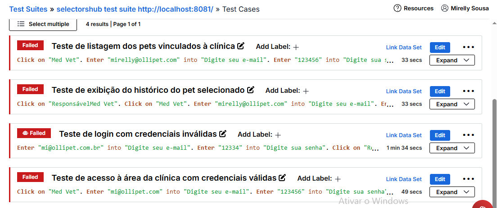

# Sprint 4 — Plano de testes manuais de sistema

## Link Organização Azure DevOps
https://dev.azure.com/RM566299/Olli-pet

## Integrantes

| RM | Integrante |
|---:|---|
| 566299 | Mirelly Sousa Alves |
| 563112 | André Rosa Colombo |
| 566242 | Gabriely Bonfim Silva |
| 562917 | Henrique Rodrigues Vespasiano |
| 562218 | Ruan Luca Feliciano de Carvalho |

# Testes Automatizados — Selenium

## Visão geral

A pasta `TESTES_SELENIUM` reúne os testes automatizados do projeto **Olli-pet**, desenvolvidos e executados utilizando o **Selenium IDE**.

Foram organizados quatro cenários de teste. Cada cenário possui seus passos de execução e evidências, permitindo consultar o fluxo automatizado, visualizar a gravação da execução, analisar os passos exportados em CSV e conferir o resultado por meio de uma captura de tela.

## Organização dos arquivos

```text
TESTES_SELENIUM/
│
├── Teste-de-acesso-à-área-da-clínica-com-...
│   ├── Prints da execução
│   ├── Arquivo .csv
│   └── Gravação da execução
│
├── Teste-de-exibição-do-histórico-do-pet-...
│   ├── Prints da execução
│   ├── Arquivo .csv
│   └── Gravação da execução
│
├── Teste-de-listagem-dos-pets-vinculados-à-...
│   ├── Prints da execução
│   ├── Arquivo .csv
│   └── Gravação da execução
│
└── Teste-de-login-com-credenciais-inválidas/
│   ├── Prints da execução
│   ├── Arquivo .csv
│   └── Gravação da execução
```

> **Observação:** os resultados das execuções automatizadas falharam devido a problemas com o click em um botão específico. Porém, nos vídeos de execução, é possível analisar o funcionamento.



## Cenários automatizados

1. **Acesso à área da clínica:** valida o fluxo de acesso à área destinada à clínica.
2. **Exibição do histórico do pet:** verifica a apresentação do histórico do animal selecionado.
3. **Listagem dos pets vinculados:** verifica a listagem dos pets associados ao contexto de acesso.
4. **Login com credenciais inválidas:** verifica o comportamento da aplicação quando são informados dados de autenticação inválidos.